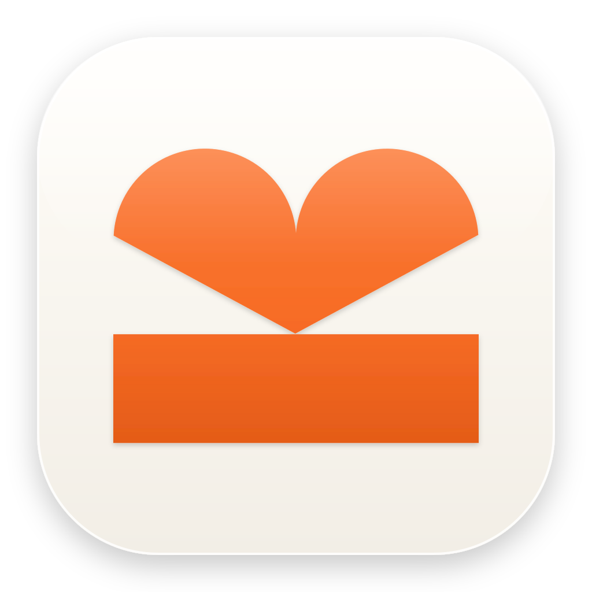
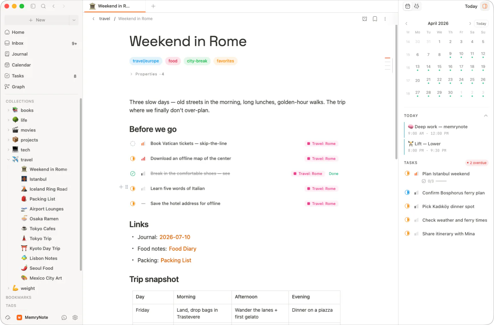
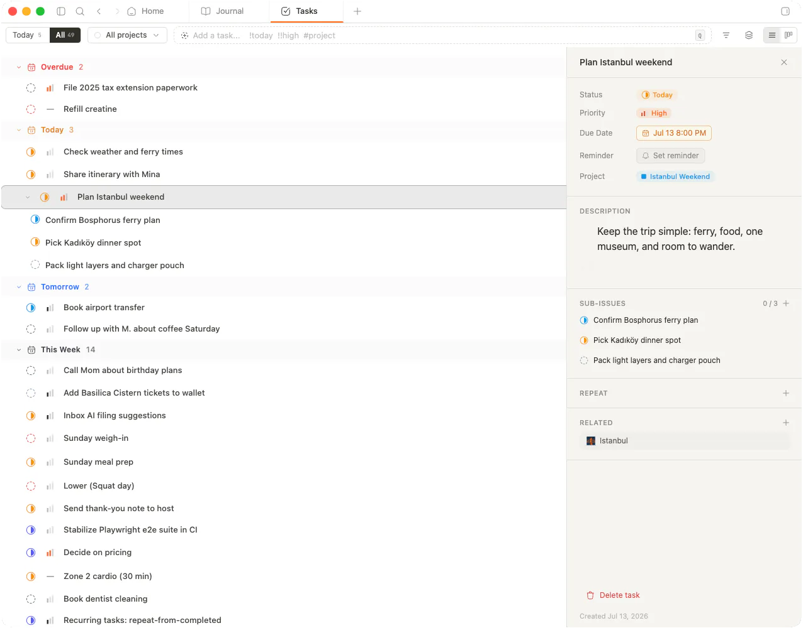
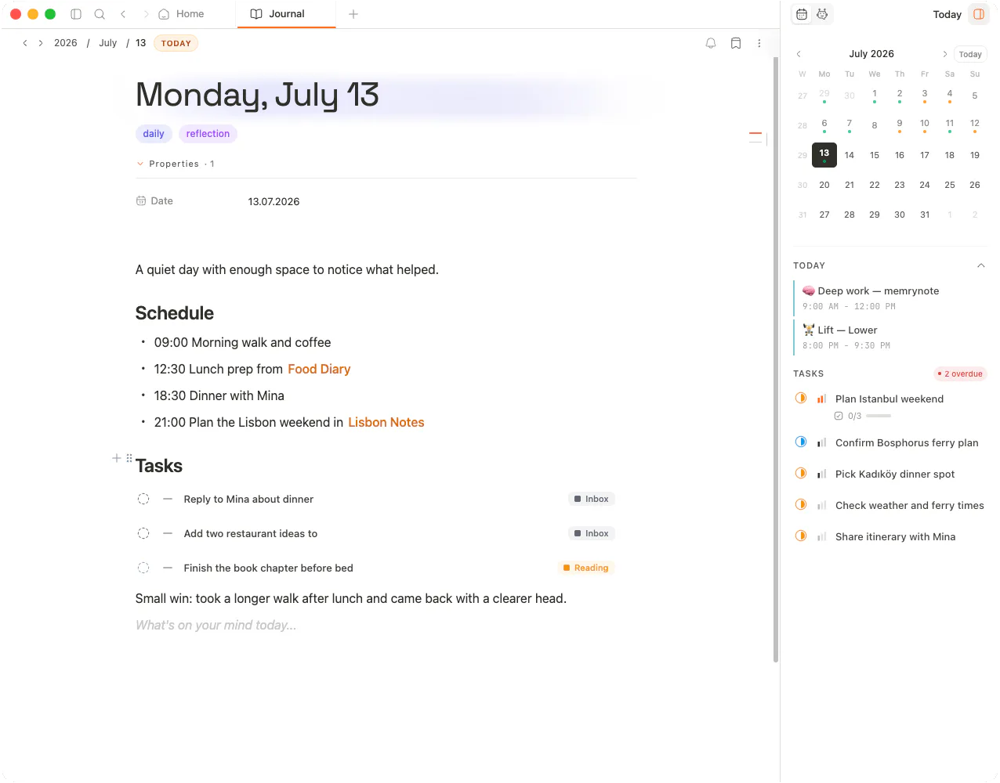
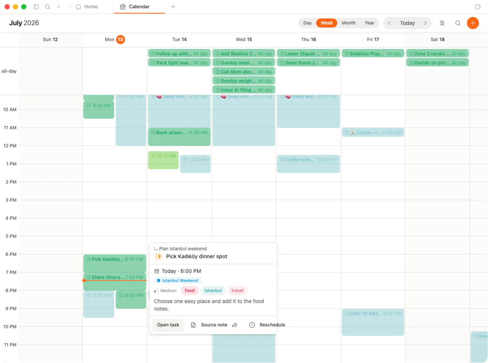
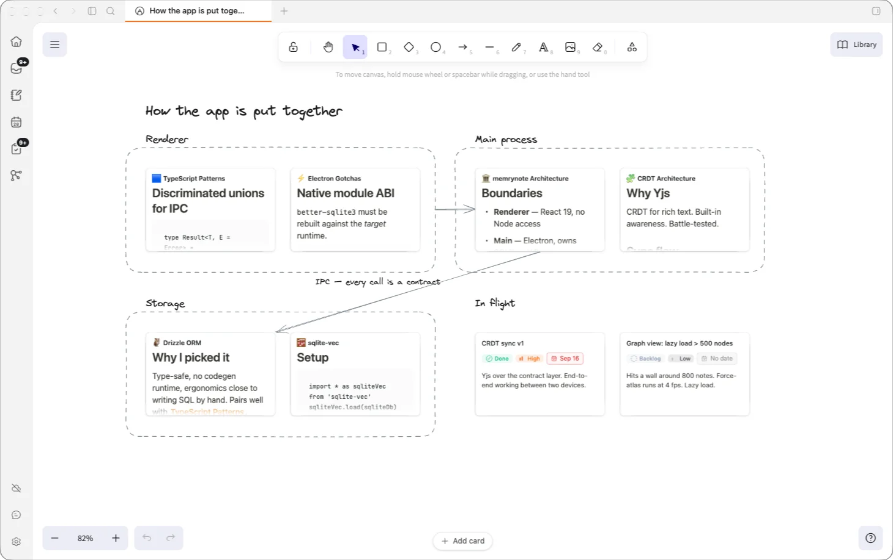
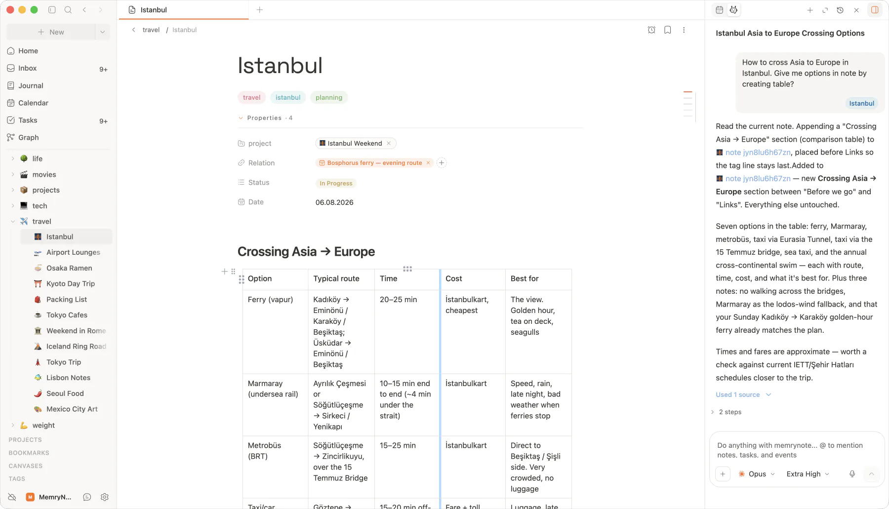
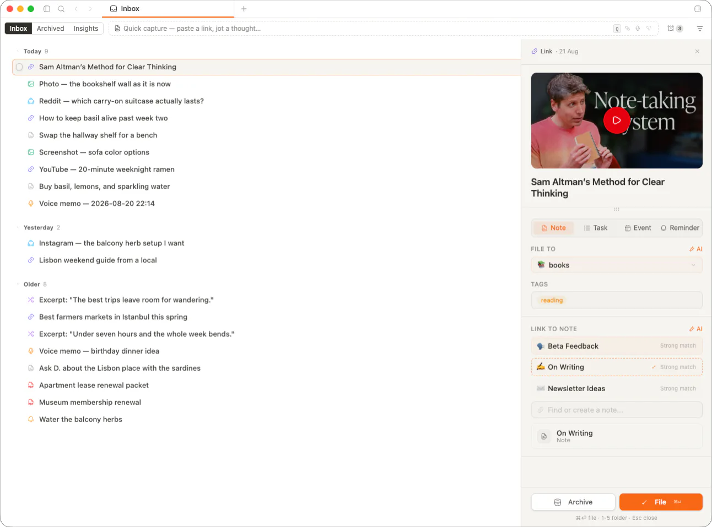

# MemryNote

### Notes, tasks, journal and calendar in one app. Your files stay on your disk, and everything that syncs is end-to-end encrypted.

[Download for Mac, Windows and Linux](https://memrynote.com/download?utm_source=github&utm_medium=referral&utm_campaign=readme&utm_content=hero) · [Website](https://memrynote.com/?utm_source=github&utm_medium=referral&utm_campaign=readme&utm_content=hero_website) · [Docs](https://docs.memrynote.com)

The desktop app is free and open source, and it needs no account. Your vault is a folder of Markdown files that any editor can open. Sync between devices is optional and paid.

## What's in it

- **Notes.** A block editor that saves Markdown. Wiki links, backlinks, properties, attachments and version history.
- **Tasks and projects.** List and kanban views, subtasks, recurrence and saved filters. Projects have their own statuses.
- **Journal.** One page per day, with templates, a calendar and a heatmap.
- **Calendar.** Day, week, month and year views over your events and dated tasks. Google Calendar is optional.
- **Inbox.** Capture links, files, voice memos, PDFs and web clips now, and file them later.
- **Canvas.** An infinite board where notes, tasks and events sit as live cards next to your drawings.
- **AI agent.** Use Claude Code, Codex, Antigravity or a local OpenAI-compatible model. It works through vault tools on a local MCP server, and you approve each write those tools make.
- **Search.** <kbd>Cmd</kbd>+<kbd>K</kbd> searches everything. With AI on, an on-device model adds semantic ranking.

Settings > Features turns off the parts you don't use. Their data stays in the vault.

<table>
  <tr>
    <td width="50%"></td>
    <td width="50%"></td>
  </tr>
  <tr>
    <td></td>
    <td></td>
  </tr>
  <tr>
    <td></td>
    <td></td>
  </tr>
</table>

## Download

| Platform                       | Get it                                                                                                                                                                                                           |
| ------------------------------ | ---------------------------------------------------------------------------------------------------------------------------------------------------------------------------------------------------------------- |
| macOS (Apple silicon or Intel) | [memrynote.com/download](https://memrynote.com/download?utm_source=github&utm_medium=referral&utm_campaign=readme&utm_content=mac), or `brew install --cask memrynote/tap/memry`                                 |
| Windows                        | [memrynote.com/download](https://memrynote.com/download?utm_source=github&utm_medium=referral&utm_campaign=readme&utm_content=windows)                                                                           |
| Linux (AppImage or .deb)       | [memrynote.com/download](https://memrynote.com/download?utm_source=github&utm_medium=referral&utm_campaign=readme&utm_content=linux)                                                                             |
| iPhone                         | TestFlight beta. [Ask for an invite](https://memrynote.com/ios-beta?utm_source=github&utm_medium=referral&utm_campaign=readme&utm_content=ios).                                                                  |
| Web clipper                    | [Chrome Web Store](https://chromewebstore.google.com/detail/memrynote-web-clipper/jnhaegegapkdlpmigfilekablabnhdnk) and [Firefox Add-ons](https://addons.mozilla.org/en-US/firefox/addon/memrynote-web-clipper/) |
| Command line                   | The `memrynote` CLI ships with the desktop app. Turn it on in Settings.                                                                                                                                          |

Every build is also on [GitHub Releases](https://github.com/memrynote/memry/releases/latest).

## How your data stays private

- The vault lives on your disk. The app works offline and without an account.
- Sync encrypts every change on your device before upload, with XChaCha20-Poly1305. Ed25519 signatures show which device wrote it. Your master key comes from your 24-word recovery phrase through Argon2id. It passes through the server only encrypted, when you link a new device.
- The sync server stores ciphertext and the routing metadata it needs. It holds no keys, so it cannot read your notes, titles or tags.
- The agent reaches your vault through a server on `localhost`. Your notes go to a model provider only when you pick a cloud model.
- Anonymous usage metrics are on by default. Settings > General > Privacy turns them off.
- No independent audit has been done yet. The sync protocol is specified in [`docs/protocol/`](docs/protocol/).

The [security white paper](https://docs.memrynote.com/architecture/security-white-paper) lists what the server can see and the known limits. Read more on the [security page](https://memrynote.com/security?utm_source=github&utm_medium=referral&utm_campaign=readme&utm_content=security) and in the [cryptography docs](https://docs.memrynote.com/architecture/cryptography).

## Sync is the only paid part

Every feature is free. A sync plan pays for the servers that move your encrypted vault between devices, on as many devices as you like.

| Plan     | Price                     | Encrypted storage | Synced vaults |
| -------- | ------------------------- | ----------------- | ------------- |
| Plus     | $5 a month or $48 a year  | 1 GB              | 1             |
| Pro      | $10 a month or $96 a year | 10 GB             | 10            |
| Believer | $500 once                 | 50 GB             | Unlimited     |

You pay on memrynote.com through Paddle, and every plan has a 14-day money-back guarantee. [See the plans](https://memrynote.com/pricing?utm_source=github&utm_medium=referral&utm_campaign=readme&utm_content=pricing).

## Star the repo

If memrynote is useful to you, star this repo. Homebrew lists a self-submitted app in its main cask repository once the project has 225 stars, and then memrynote installs without the tap.

## A note from me

I'm [Kaan](https://x.com/h4yfans). For years I bounced between four apps just to get through a day, and with ADHD, that jumping drained me before I'd started. I wanted one calm place that held all of it _and_ an agent that already knew my work. Nothing did it without renting my brain back to me from a server I didn't control. So I built MemryNote. It's the app I wish I'd had.

## Build from source

To run it locally, hack on it or contribute, start with [docs/DEVELOPMENT.md](docs/DEVELOPMENT.md) and [docs/CONTRIBUTING.md](docs/CONTRIBUTING.md). The [architecture docs](https://docs.memrynote.com/architecture) explain how the app works.

## Roadmap

[memrynote.com/roadmap](https://memrynote.com/roadmap?utm_source=github&utm_medium=referral&utm_campaign=readme&utm_content=roadmap)

## Support

MemryNote is free and stays free. Sync is the only paid part, and nothing here unlocks a feature. If the app saves you time and you want to chip in, sponsoring covers certificates, servers, and developer fees.

## Community

[r/memrynote](https://www.reddit.com/r/memrynote/) · [@X](https://twitter.com/h4yfans) · [Issues](https://github.com/memrynote/memry/issues) · kaan@memrynote.com

Ship a workflow you love? Tell us. Something broken? Tell us louder.

---

## Star History

<a href="https://www.star-history.com/?repos=memrynote%2Fmemry&type=date&legend=top-left">
 <picture>
   <source media="(prefers-color-scheme: dark)" srcset="https://api.star-history.com/chart?repos=memrynote/memry&type=date&theme=dark&legend=top-left&sealed_token=nt-KwjHrpgaEjiel8Y6JI55_pssUa-b9RV2qChgEyRsnKF0d23dlT5aN2Iw87tTpBJEA8mv294j5EWL_QYZ6DXp1mo7inKpknctBhPpZCAa6WpECwNd_6-4O_UIfTQXxn9NfOHjznkgrzCFGutKCO4NmfRYpY5aNTt_myfgT9ygX5HopO4U36xcQfyHF" />
   <source media="(prefers-color-scheme: light)" srcset="https://api.star-history.com/chart?repos=memrynote/memry&type=date&legend=top-left&sealed_token=nt-KwjHrpgaEjiel8Y6JI55_pssUa-b9RV2qChgEyRsnKF0d23dlT5aN2Iw87tTpBJEA8mv294j5EWL_QYZ6DXp1mo7inKpknctBhPpZCAa6WpECwNd_6-4O_UIfTQXxn9NfOHjznkgrzCFGutKCO4NmfRYpY5aNTt_myfgT9ygX5HopO4U36xcQfyHF" />
   
 </picture>
</a>

AGPL-3.0 © MemryNote contributors. Private by design, open at heart.

