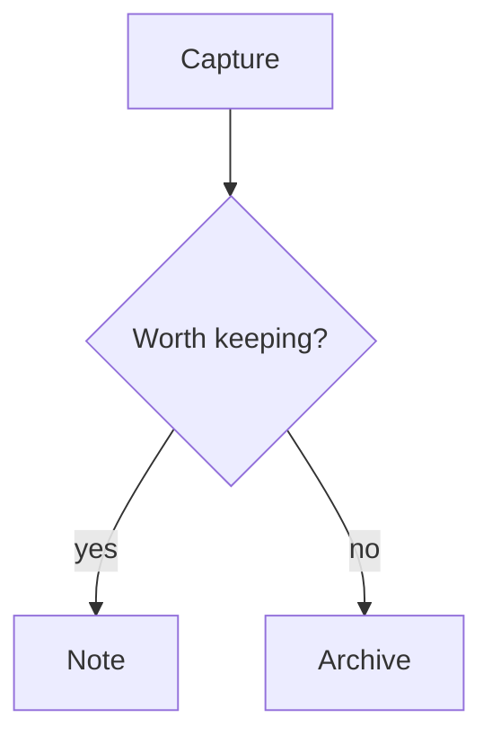

---
tags:
  - notes-101
level: Intermediate
summary: 'Code blocks, equations, Mermaid diagrams and live views of your notes'
---
Blocks for technical writing, and for letting a note show other notes.

## Code

**Insert:** type three backticks, or **/code**. A small toolbar in the block's corner picks the language (50 of them) and copies the code. Highlighting follows your theme.

```ts
const measure: number = 66
  console.log(`line length: ${measure} characters`)
```

```python
print("one small step")
```

```text
plain text, no highlighting
```

Inline code, for a word or two, is Cmd+E on a selection.

## Equations

**Insert:** slash menu, **Equation**. The block takes LaTeX and draws it. Click it to edit the source.

$$
t_{\text{read}} = \frac{\text{words}}{238} \text{ min}
$$

## Diagrams

**Insert:** **/mermaid** (also **/diagram**, **/flowchart**). The block draws a Mermaid diagram from a few lines of text. Click it to edit the source; the picture redraws as you type. It is stored as an ordinary Mermaid code fence, so GitHub and Obsidian draw it too.



## Live views

**Insert:** **/view**. A view is a live list of notes from the whole vault, a folder or a tag, as a list, table or gallery. It updates as notes change. This one shows every note tagged space-race:

```memry-view
{
  "source": {
    "kind": "tag",
    "tag": "space-race"
  },
  "layout": "table"
}
```

## Charts

**Insert:** **/chart**. A chart plots one property over time. This one plots the sleep property from the journal over the last 90 days:

```memry-view
{
  "source": {
    "kind": "journal"
  },
  "layout": "chart",
  "chart": {
    "property": "sleep",
    "rangeDays": 90
  }
}
```

Views and charts are fenced text, so older versions and other apps show them as plain code. Nothing is lost.

Next: [[05 Tables]].
