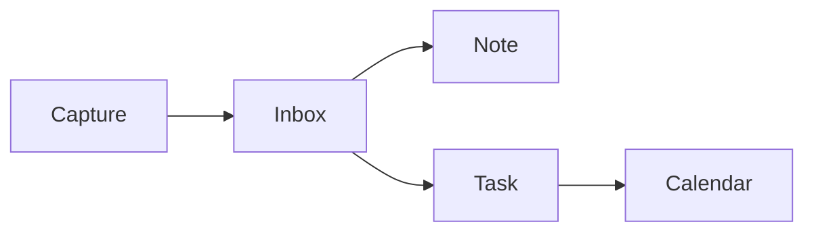

---
tags:
  - ios-parity
  - testing
  - tech/typescript
aliases:
  - Parity Kitchen Sink
author: Frank Herbert
rating: 4
deadline: '2026-12-14'
shared: true
url: 'https://memry.app'
status: active
priority: high
format:
  - Kindle
  - Audiobook
related:
  - 'memry://note/note_seed00000000'
  - 'memry://note/note_seed00000003'
project:
  - memrynote Launch
---
Test note for iOS parity. Every block type, inline type, style, tag and property type appears at least once. Headings name the section, so compare each section with desktop.

# 1. Headings (H1-H6)

## Heading level 2

### Heading level 3

#### Heading level 4

##### Heading level 5

###### Heading level 6

## 2. Inline styles

Plain, **bold**, *italic*, <span style="text-decoration:underline">underline</span>, ~~strike~~, `inline code`, ***bold+italic***.

Colours: <span style="color:red">red</span> <span style="color:blue">blue</span> <span style="color:green">green</span> <span style="color:purple">purple</span>, highlight: <span style="background-color:yellow">yellow</span> <span style="background-color:pink">pink</span>, both: <span style="color:red;background-color:yellow">red on yellow</span>.

## 3. Inline nodes

Link: [memry.app](https://memry.app). Wiki link: [[Dune]]. Wiki link with alias: [[Deep Work|Cal Newport book]]. Broken wiki link: [[A Note That Does Not Exist]].

Path wiki links (two notes are titled Roadmap, so autocomplete writes the folder): [[parity-links/Roadmap]], [[parity-links/archive/Roadmap#Goals|Archived roadmap goals]], [[/parity-links/archive/Roadmap.md]].

Tags: #ios-parity #testing. Link mention: ((mention:https%3A%2F%2Fgithub.com%2Fmemrynote%2Fmemry)).

Date: ((date:eyJhbmNob3JJZCI6InBhcml0eS1kMSIsImRhdGVJU08iOiIyMDI2LTEyLTAyVDA5OjAwOjAwLjAwMFoiLCJoYXNUaW1lIjp0cnVlLCJkYXRlRm9ybWF0IjoicmVsYXRpdmUiLCJyZW1pbmQiOiJub25lIiwidGltZUZvcm1hdCI6InN5c3RlbSJ9)), with reminder: ((date:eyJhbmNob3JJZCI6InBhcml0eS1kMiIsImRhdGVJU08iOiIyMDI2LTEyLTE0VDAwOjAwOjAwLjAwMFoiLCJoYXNUaW1lIjpmYWxzZSwiZGF0ZUZvcm1hdCI6ImZ1bGwiLCJyZW1pbmQiOiIxZCIsInRpbWVGb3JtYXQiOiJzeXN0ZW0ifQ)).

## 4. Block colours and alignment

<!-- align:center -->
Centred paragraph.

<!-- align:right -->
Right-aligned paragraph.

<!-- align:justify -->
Justified paragraph: this sentence is long enough to wrap across several lines on a phone, so the justification is visible.

<!-- colors:{"textColor":"blue"} -->
Paragraph with blue text colour.

<!-- colors:{"backgroundColor":"yellow"} -->
Paragraph on a yellow background.

<!-- colors:{"textColor":"red","backgroundColor":"gray"} -->
Red text on a gray background.

## 5. Lists

- Bullet one
  - Nested bullet
    - Two levels deep
- Bullet two
1. First (1)
2. Second (2)
3. Third (3)

A paragraph in between: numbering must restart below. <!-- a hidden comment [[Inbox]] -->

1. Restarted (1)
2. Restarted (2)
   1. Nested numbered (2.1)
   2. Nested numbered (2.2)

- [x] Checked item {task:5Lxgdus8NooCRwCg2QuFR}

- [ ] Unchecked item {task:8QdJKAx6St1cr31puP6zh}

A plain checklist, not tracked as tasks:

- [x] Plain checked
- [ ] Plain unchecked

## 6. Toggle

<details data-memry-toggle>
<summary>Closed toggle (tap to open)</summary>

Hidden body text.

</details>

<details data-memry-toggle open>
<summary>Open toggle</summary>

Body of the open toggle.

<details data-memry-toggle>
<summary>Nested toggle</summary>

Deepest body.

</details>

</details>

Columns, written as an Obsidian Multi-Column Markdown region:

--- start-multi-column: parity
```column-settings
Number of Columns: 2
```

Left column

--- end-column ---

Right column

--- end-multi-column

## 7. Quote and callouts

> A plain quote block.

> A structured quote holds more than one block.
>
> - A list inside the quote
> - Second item

> [!info]
> Info callout.

> [!warning]
> Warning callout.

> [!error]
> Error callout.

> [!success]
> Success callout.

## 8. Code

```typescript
function greet(name: string): string {
  return `Hello, ${name}`
}
```

```python
def greet(name):
    return f"Hello, {name}"
```

## 9. Divider

Above the divider.

***

Below the divider.

## 10. Table

<!-- table-colors:{"1:1":{"backgroundColor":"green"},"2:1":{"textColor":"red","backgroundColor":"yellow"}} -->
<!-- table-layout:{"columnWidths":[160,null,120]} -->
| Feature             | Status        | Note                                              |
| ------------------- | ------------- | ------------------------------------------------- |
| **Read**            | Done          | Wiki: [[Dune]]                                    |
| Edit                | In review     | Tag: #ios-parity                                  |
| [x] inline checkbox | [ ] unchecked |  |

## 11. Attachments


<!-- file:{"url":"attachments/p3h56icp44ni/parity-spec.pdf","name":"parity-spec.pdf","size":12978,"mimeType":"application/pdf"} -->

<!-- file:{"url":"attachments/p3h56icp44ni/parity-voice.m4a","name":"parity-voice.m4a","size":27680,"mimeType":"audio/mp4"} -->

<!-- file:{"url":"attachments/p3h56icp44ni/parity-clip.mp4","name":"parity-clip.mp4","size":65093,"mimeType":"video/mp4"} -->

## 12. Embeds


## 13. Task block

- [ ] Renew driver license {task:q3iHEEmtaPQWIhxu1H1X1}

## 14. Non-ASCII

Türkçe: çğıöşü ÇĞİÖŞÜ. Grüße, 世界, «citation» 🙂

## 15. Review comments (read only on iOS)

This sentence has {==a highlighted comment==}{>>id=critic-comment-4061-10gv85t;type=comment | Check this renders on iOS<<}, an insertion and a deletion.

## 16. Diagram (Mermaid)



## 17. Math

$$
\int_0^1 x^2 \, dx = \frac{1}{3}
$$
