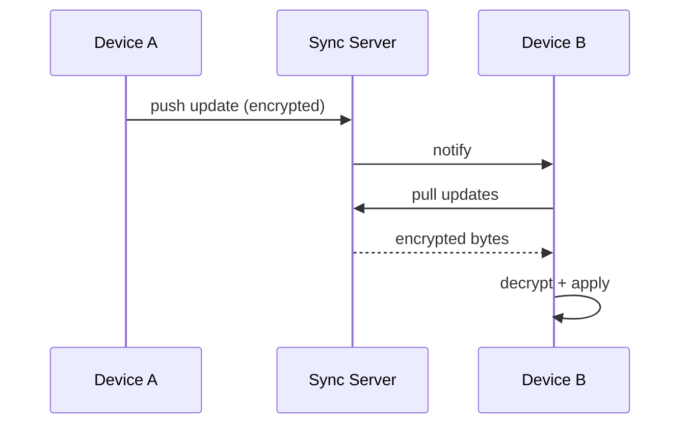

---
tags:
  - tech/sync
  - tech/architecture
project:
  - memrynote Launch
area: Learning
level: advanced
status: active
---
## Why Yjs

CRDT for rich text. Built-in awareness. Battle-tested.

## Sync flow

## Field-level vector clocks

For tasks/projects — see the [[Drizzle ORM]] schema for `field_clocks` JSON column. This avoids whole-row LWW for structured records.

## Footnote on naming

Yes, "CRDT" is overloaded[^1]. Yjs implements a state-based CRDT (specifically a YATA variant).

[^1]: Operational vs state vs delta-state CRDTs are all called "CRDTs" in conversation. Worth being precise in PR reviews.

#tech/sync #tech/architecture
